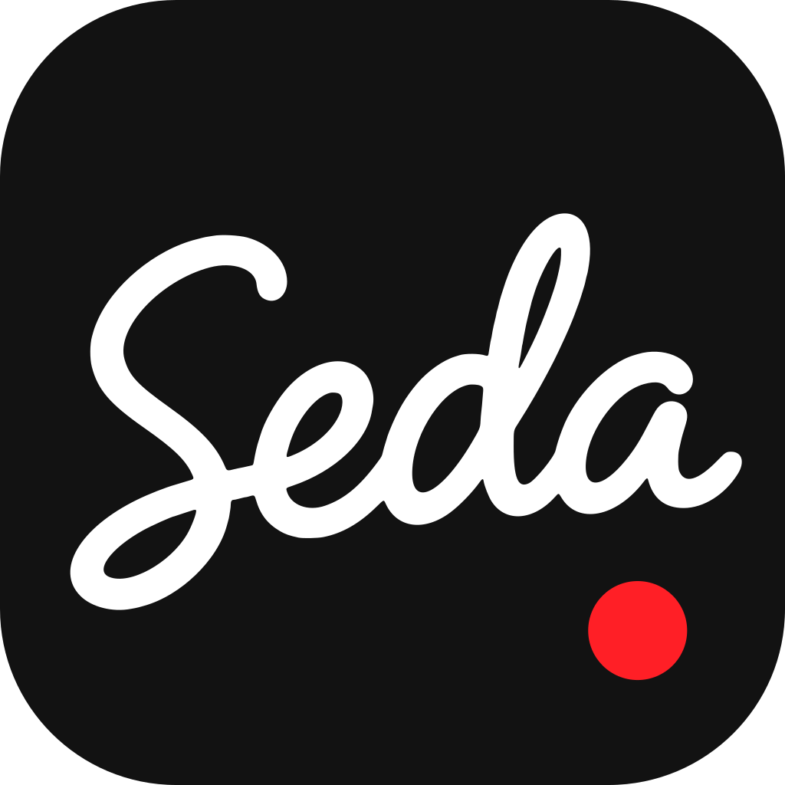

<p align="center"></p>

# Seda

Private voice typing and meeting notes for Windows. Everything runs on your own computer: nothing you say is uploaded.

**[Download the installer](https://github.com/d1same/seda/releases/latest)** (Windows 10/11, 64-bit)

- **Dictation anywhere.** Hold a shortcut (any key or mouse button, e.g. Mouse 4), talk, let go: clean, punctuated text is pasted where your cursor is. Say "no wait…" and Seda drops the part you took back.
- **English + one more language.** Mix them in the same sentence. Persian has its own fine-tuned speech model; Chinese, Hindi, Spanish, Arabic, French, Portuguese, Russian, German, Japanese and Greek use the multilingual one.
- **Writing AI.** A local model adds punctuation and paragraphs, and matches the app (email layout in Outlook/Gmail, bullets in Jira, casual in Teams/Slack).
- **Fix my text.** Select text anywhere, press a shortcut: correct grammar, make it formal, friendly, shorter, or translate.
- **Meetings.** Records you (microphone) and everyone else (the computer's audio), transcribes live, and writes notes with decisions and action items when the call ends. No bot joins your call. Seda notices when Teams, Zoom, Meet and others start a call and offers to take notes.
- **Ask about a meeting.** "What did I agree to do?", "Write a follow-up email", "Make the notes shorter": answers and edits come from the local AI.
- **Learns from you.** Correct a dictation once and Seda remembers the fix; add names and terms it should always spell right.

## How it works

| Part | What runs locally |
|---|---|
| Speech to text | [whisper.cpp](https://github.com/ggerganov/whisper.cpp) (Vulkan GPU), large-v3-turbo; a Persian fine-tune for Persian |
| Voice detection | Silero VAD |
| Writing AI | [llama.cpp](https://github.com/ggerganov/llama.cpp) server with Gemma 4 (E4B or E2B, picked by your PC's memory) |
| App | [Tauri 2](https://tauri.app) (Rust) + React |

The first run downloads the models (about 5 GB for the full package, less for the light ones) into `%LOCALAPPDATA%\SedaModels`. Your settings, history and meetings stay in `%APPDATA%\Seda`.

## Build from source

Requirements (Windows 10/11, x64):

1. [Rust](https://rustup.rs) (MSVC toolchain) and [Node.js](https://nodejs.org) 20+
2. Visual Studio 2022 Build Tools (C++ workload, includes CMake)
3. [LLVM](https://github.com/llvm/llvm-project/releases) (for `libclang`)
4. [Vulkan SDK](https://vulkan.lunarg.com/sdk/home)

Check the tool paths in `src-tauri/.cargo/config.toml`, then:

```bash
npm install
npm run tauri build
```

The installer is written to `<target-dir>/release/bundle/nsis/`. For development: `npm run tauri dev`. Running `npm run dev` alone opens the interface in a browser with sample data.

## Publish a release

Set the same version in `package.json`, `src-tauri/tauri.conf.json`, and `src-tauri/Cargo.toml` first. `0.2.10` below means that version. Paste this from any folder:

```powershell
cd Z:\Projects\Whisper\seda
Set-ExecutionPolicy -Scope Process -ExecutionPolicy Bypass
Set-Content notes.md "What changed, in one or two sentences."
.\scripts\release.ps1 -Version 0.2.10 -Notes notes.md
```

The build takes a while. When the window says to expect a password, press Enter. The password is empty. GitHub gets the installer and `latest.json`, and a copy is saved in `Z:\Projects\Whisper\installer`.

If the installer is already built, sign and publish that file:

```powershell
cd Z:\Projects\Whisper\seda
Set-ExecutionPolicy -Scope Process -ExecutionPolicy Bypass
.\scripts\release.ps1 -Version 0.2.10 -Notes notes.md -SkipBuild
```

Compiler files stay in `Z:\Projects\Whisper\b`. The shader tool uses `Z:\Projects\Whisper\shader`. The signing key is `%USERPROFILE%\.tauri\seda-updater.key`.

## Privacy

- Audio, transcripts, notes and settings never leave your PC. The only network traffic is the one-time model download and a check on GitHub for new versions every few hours.
- Call detection reads Windows' own "which app is using the microphone" list; Seda records only after you press Start (or if you choose "Record automatically" in Settings).
- Meeting audio is transcribed as you talk and never saved: only the transcript and notes stay (you can turn on "Keep meeting recordings" in Settings).
- Delete any dictation or meeting from the app; any saved audio is deleted with it, and the text is overwritten in the database.

## Security

- **The writing AI is locked down.** It listens only on this PC, on a random port, with a password that is new on every launch and known only to Seda. Its status endpoints and browser access are off, so websites can't reach it, and Seda checks that the process answering is the one it started.
- **Downloads are verified.** Every model and the AI engine are pinned to an exact version and checked against their published SHA-256 fingerprints; anything that doesn't match is deleted and refused.
- **Signed updates.** Seda updates itself from this repository's releases, and only installs an update whose digital signature matches Seda's key; a tampered or fake update is refused.
- **No admin rights, no open ports to the network, no telemetry.**
- **The app's windows are sandboxed** with a strict Content Security Policy, and commands that type into your apps or use the microphone only work from the window they belong to. Model and engine paths are accepted only from Seda's own models folder.
- **Dictated text stays out of Windows clipboard history and cloud clipboard**, is pasted only into the window you started dictating in (never as multiple lines into a terminal), and is never written to the log.
- Found a problem? Please open an issue.

## License

[MIT](LICENSE): free to use, change and share, including commercially. The AI models Seda downloads have their own licenses: Whisper (MIT), the Persian Whisper fine-tune, Silero VAD (MIT), Gemma (Gemma Terms of Use).
