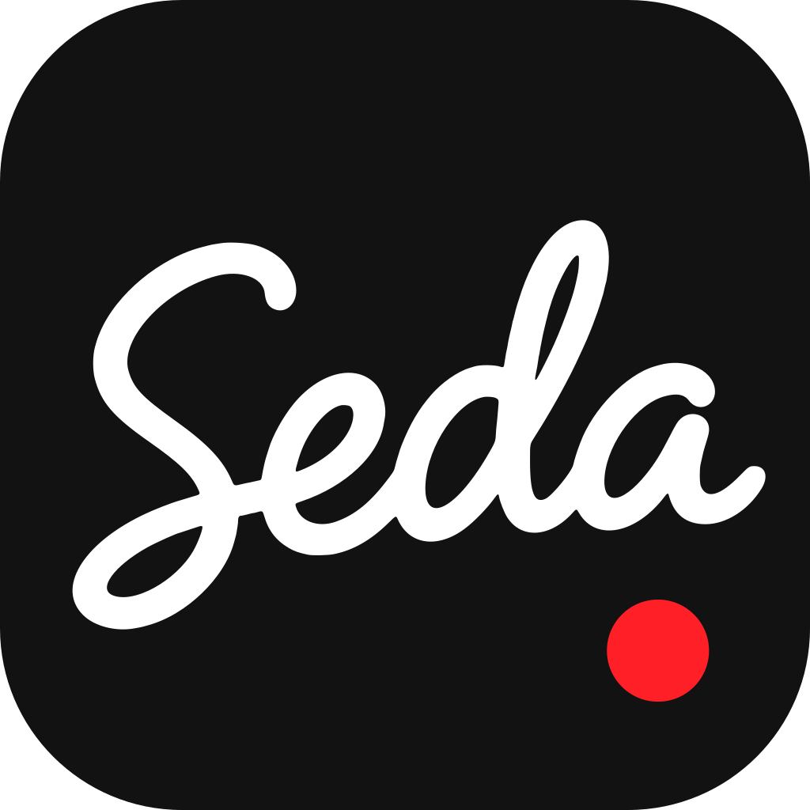

<p align="center"></p>

# Seda

Private voice typing and call/meeting notes for **Windows** and **Android**. Everything runs locally on your own device — nothing you say is uploaded.

## Download

Both Windows and Android share matching versions on the **[Latest Release](https://github.com/d1same/seda/releases/latest)** page:

| Platform | Download | Requirements | Updates |
|---|---|---|---|
| **Windows** | `Seda_<version>_x64-setup.exe` | Windows 10/11 (64-bit) | Built-in signed auto-updater |
| **Android** | `Seda-Android-<version>-arm64.apk` | Android 9+ (ARM64) | Built-in in-app updater |

## Highlights

### Windows
- **Dictation anywhere.** Hold or tap a shortcut (any key or mouse button) and talk. Words appear live and paste right at your cursor. Say *"no wait…"* and Seda keeps only your final thought.
- **Auto-detect & multilingual.** Automatically detects 99+ languages, or lock to English or a second language (with a dedicated Persian + English model).
- **Local writing cleanup.** Optional on-device punctuation, cleanup, and app-aware formatting (email layout in Outlook/Gmail, bullets in issue trackers, casual in chat).
- **Fix selected text.** Select text anywhere and press a shortcut to fix grammar, rewrite tone, shorten, or translate locally.
- **Snippets & personal vocabulary.** Add custom spoken shortcuts (like *"my email"*) and names or terms Seda should always spell right.
- **Bot-free meeting notes.** Captures your mic and system audio locally, detects calls in Teams, Zoom, Meet, and more, writes structured notes with decisions and action items, and lets you search or ask questions across all meetings.

### Android
- **100% on-device call & meeting notes.** Runs ARM64-optimized `whisper.cpp` (FP16 + dotprod) + Silero VAD + `llama.cpp` directly on your phone with zero cloud upload.
- **Automatic cellular & VoIP call recording.** Supports cellular calls plus WhatsApp, Telegram, Google Voice, Signal, Teams, Zoom, Google Meet, and Discord, along with call-folder auto-import and **Share → Seda** for any audio file.
- **Structured notes & search.** Clickable task checkboxes, "My notes" merge, full-text search, Auto-detect language (99+ languages), and cited Q&A across all your calls.
- **Adaptive layout & in-app updates.** Adapts automatically to phones and foldables, and checks GitHub Releases for 1-tap in-app updates.

## How it works

| Component | Local Engine |
|---|---|
| Speech to text | [whisper.cpp](https://github.com/ggerganov/whisper.cpp) (`large-v3-turbo`, plus a Persian fine-tune for Farsi) |
| Voice detection | Silero VAD |
| Notes & writing AI | [llama.cpp](https://github.com/ggerganov/llama.cpp) with Gemma 4 (E4B or E2B, chosen for your device's RAM) |
| App framework | [Tauri 2](https://tauri.app) (Rust) + React |

On first launch, Seda downloads the selected AI models once (verified by SHA-256) directly onto your device.

## Build from source (Windows)

Requirements (Windows 10/11, x64):
1. [Rust](https://rustup.rs) (MSVC toolchain) and [Node.js](https://nodejs.org) 20+
2. Visual Studio 2022 Build Tools (Desktop development with C++, including CMake)
3. [LLVM](https://github.com/llvm/llvm-project/releases) (for `libclang`)
4. [Vulkan SDK](https://vulkan.lunarg.com/sdk/home)

Adjust any local tool paths in `src-tauri/.cargo/config.toml` if needed, then run:

```powershell
git clone https://github.com/d1same/seda.git
cd seda
npm install
npm run tauri dev
```

To build a release installer:

```powershell
npm run tauri build -- --no-sign
```

## Privacy & Security

- **100% local processing.** Audio, transcripts, notes, and settings stay on your device. The only network traffic is the one-time model download and optional GitHub release checks.
- **Verified downloads & signed updates.** Every model and engine binary is pinned and checked against its SHA-256 checksum. App updates are cryptographically verified before installing.
- **Isolated local AI engine.** Runs strictly on `127.0.0.1` on an ephemeral port with a per-launch random API token, web UI disabled, no proxy/redirects, and process ownership checks.
- **Sandboxed UI & private clipboard.** Strict Content Security Policy, per-window IPC restrictions, and dictated text excluded from Windows clipboard history and cloud sync.

## License

[MIT](LICENSE). Downloaded AI models are governed by their respective upstream licenses (Whisper: MIT, Silero VAD: MIT, Gemma: Gemma Terms of Use).
